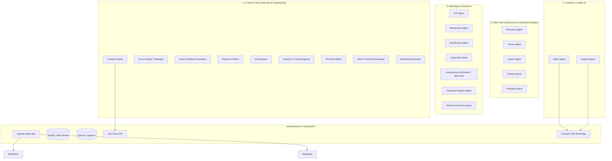

# Sistema de Agentes de IA - CloudFly Ecosystem

Este documento cataloga y detalla la arquitectura, roles, herramientas y flujos de ejecución de todos los agentes inteligentes implementados y operativos en la plataforma CloudFly.

---

## 1. Visión General del Ecosistema de Agentes

CloudFly opera con un modelo híbrido multi-agente impulsado por **CrewAI**, **LangChain**, modelos LLM (OpenRouter, OpenAI, Groq, NVIDIA NIM) y almacenes vectoriales (**Qdrant** y **pgvector**). Los agentes están organizados en clusters según su dominio de especialización:

---

## 2. Catálogo de Agentes por Módulo

### A. AI Scrum Team (`ai_scrum_team/`)
Diseñado para la ejecución autónoma o asistida del ciclo de vida de desarrollo de software (SDLC) sobre tareas y tickets de Jira.

| Agente | Rol / Backstory | Herramientas (Toolsets) | Objetivo Principal |
| :--- | :--- | :--- | :--- |
| **Product Owner** | Experto Agile PO | `jira_only_tools` | Define User Stories, criterios de aceptación (Gherkin/AC) y prioriza backlog en Jira. |
| **Scrum Master** | Agile Manager & Facilitador | Sin tools de código (delega en proceso jerárquico) | Gestiona el sprint, elimina bloqueos y coordina delegación de tareas. |
| **Senior Software Developer** | Desarrollador políglota senior | `dev_tools` (FS, Terminal, Docker, Jira, WebSearch) | Escribe código limpio, configuración de servicios, scripts y lógica de negocio. |
| **System Architect** | Arquitecto e Investigador Técnico | `dev_tools` (Web Search, File inspection, Jira) | Diseña blueprints arquitectónicos, diagramas y contratos de API. |
| **QA Engineer** | Quality Assurance Specialist | `qa_tools` (dev_tools + Chrome DevTools CDP) | Valida criterios de aceptación, ejecuta tests unitarios, visuales y E2E. |
| **DevOps & Cloud Engineer** | Automatizador de infraestructura | `dev_tools` (Docker, SSH/VPS, Terminal, Git) | Prepara pipelines, contenedores Docker y scripts de despliegue en VPS/Cloud. |
| **Technical Writer** | Documentador y especialista en diagramas | `jira_only_tools` | Genera documentación Markdown, arquitectura y diagramas Mermaid.js. |
| **Senior Frontend Developer** | Especialista UI/UX Next.js & Tailwind | `dev_tools` (Next.js, TypeScript, NPM) | Construye interfaces modernas y componentes en `frontend_new`. |
| **Marketing Specialist** | Growth Hacker & Estratega | `jira_only_tools` | Diseña planes de lanzamiento y copy alineado con el backlog del producto. |

---

### B. Web Team - Autonomous Storefront Engine (`web-team/`)
Microservicio basado en eventos de Kafka para construir y publicar tiendas virtuales completas de forma automatizada a partir de los datos y catálogo de cada empresa.

* **Discovery Crew (`discovery_crew.py`)**: Analiza la identidad de la empresa, nicho de mercado, paleta de colores y catálogo de productos.
* **Theme Crew (`theme_crew.py`)**: Genera el diseño visual, tokens CSS, fuentes y variables temáticas acordes a la identidad.
* **Layout Crew (`layout_crew.py`)**: Estructura las páginas (Home, Categorías, Detalle de Producto, Checkout) y componentes visuales.
* **Content Crew (`content_crew.py`)**: Redacta textos comerciales, micro-copy, llamados a la acción (CTAs) y metadata SEO optimizada.
* **Publisher Crew (`publisher_crew.py`)**: Compila la plantilla final, guarda el estado en base de datos (`company_website`), invalida caché en Redis y activa el sitio en el dominio correspondiente.
* **Workers de Soporte**:
  - `model_health_worker.py`: Monitorea la disponibilidad y latencia de los proveedores LLM y balancea las llamadas.
  - `recovery_worker.py`: Detecta sitios web en estado `CONSTRUCTION` pendientes y relanza su ensamblaje por Kafka.

---

### C. Marketing & Growth AI (`marketing_team_ai/`, `marketing_agent/`, `ia_marketing_operation/`)
Ecosistema encargado de la prospección, análisis de audiencia y ejecución de pauta digital.

1. **Equipo de Prospección y Cualificación (`marketing_team_ai/agents/`)**:
   - `icp_agent.py`: Define el Ideal Customer Profile según el segmento del negocio.
   - `researcher_agent.py`: Investiga prospectos, competidores y señales de compra mediante scrapers y web search.
   - `qualification_agent.py`: Evalúa y puntúa leads entrantes para determinar su madurez comercial.
   - `copywriter_agent.py`: Genera copys persuasivos para correos, WhatsApp y anuncios publicitarios.
2. **Meta Ads & Autonomous Campaign Worker (`marketing_agent/`)**:
   - `ai_ad_service.py` & `autonomous_worker.py`: Conexión con Meta Graph API / Facebook Ads para creación, ajuste presupuestario y optimización de campañas publicitarias.
3. **Análisis Profundo y Descubrimiento (`ia_marketing_operation/agents/`)**:
   - `company_analysis_agent.py`: Auditoría profunda del negocio, propuesta de valor y matriz FODA.
   - `schema_discovery_agent.py`: Deduce y mapea modelos de datos de clientes para personalización extrema.

---

### D. Agentes Conversacionales en Producción (`ai-agent/`)
Agentes de cara al cliente conectados a canales de mensajería (WhatsApp mediante Evolution API, Chat Web):

- **Sales Agent (`sales_agent.py`)**:
  - Atención proactiva de prospectos.
  - Consulta de catálogo, stock y precios en tiempo real.
  - Creación de cotizaciones y pedidos directamente en el backend.
- **Support Agent (`support_agent.py`)**:
  - Resolución de dudas frecuentes con base en la documentación indexada en Qdrant/pgvector.
  - Consulta de estado de pedidos y escalamiento a agentes humanos cuando se requiere.

---

## 3. Configuración y Balanceo de Modelos (LLM Routing)

Los agentes implementan un esquema de resiliencia y balanceo dinámico:
- **Proveedores Soportados**: OpenRouter, OpenAI, Groq, NVIDIA NIM.
- **Configuración Principal**: Variable de entorno `MODEL_DEFAULT` en formato `proveedor/modelo` (ej. `openrouter/owl-alpha`, `openai/gpt-4o`).
- **Health Checks**: Los módulos cuentan con monitores de salud (`model_health_worker.py`) que comprueban disponibilidad de endpoints y cambian a proveedores de respaldo ante cuotas excedidas o latencia alta.

