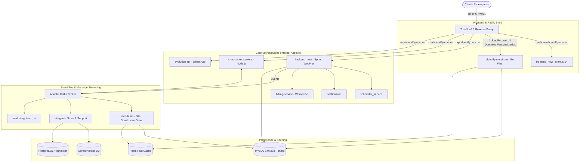

# Auditoría de Estado Actual del Repositorio — CloudFly Business OS

**Fecha de Auditoría:** Noviembre 2026  
**Auditor:** Equipo Multidisciplinario de Auditoría Tecnológica (Antigravity Senior Team)  
**Alcance:** Código fuente, configuraciones, microservicios, bases de datos y herramientas de despliegue en `c:\apps\cloudfly`  
**Estado de la Rama:** `main` (sincronizada con `origin/main`)

---

## 1. Inventario Estructurado de Directorios y Componentes

El repositorio CloudFly cuenta con una arquitectura políglota de microservicios reactivos, contenedores Docker, aplicaciones frontend/mobile y agentes autónomos.

### 1.1. Componentes Activos de Producción y Desarrollo Principal
| Componente / Directorio | Lenguaje / Stack | Rol en la Plataforma | Estado Operativo | Evidencia de Código |
| :--- | :--- | :--- | :---: | :--- |
| **`backend_new/`** | Java 17, Spring Boot 3.4 (WebFlux), Spring Data R2DBC, Maven | Core API Reactiva. Gestión de empresas, contactos, productos, pedidos, facturas, roles, autenticación JWT. | **IMPLEMENTADO Y VERIFICADO** | `backend_new/src/main/java/com/app/controllers/` (43 controladores) |
| **`frontend_new/`** | TypeScript, Next.js 14.2 (App Router), MUI v6, Tailwind CSS, Redux Toolkit | Dashboard administrativo multi-tenant, onboarding, tienda, catálogo, ventas y marketing UI. | **IMPLEMENTADO Y VERIFICADO** | `frontend_new/src/app/(dashboard)/` y `frontend_new/src/app/(blank-layout-pages)/` |
| **`web-team/`** | Python 3.11+, CrewAI, Kafka, Redis, SQLAlchemy | Constructor autónomo de tiendas virtuales impulsado por LLM y eventos de Kafka. | **IMPLEMENTADO Y VERIFICADO** | `web-team/src/main.py`, `src/crews/`, `src/recovery_worker.py` |
| **`cloudfly-storefront/`** | Go 1.21+, GoFiber, Fiber HTML Templates, Redis, MySQL | Motor de renderizado público y de alto rendimiento para tiendas generadas dinámicamente por tenant. | **IMPLEMENTADO Y VERIFICADO** | `cloudfly-storefront/cmd/server/`, `internal/handlers/home.go` |
| **`ai-agent/`** | Python, FastAPI, LangChain/OpenAI, Qdrant, MySQL, Redis, Kafka | Agente conversacional de ventas y soporte para WhatsApp/Chat web con RAG. | **IMPLEMENTADO SIN VERIFICAR** | `ai-agent/app.py`, `ai-agent/agents/sales_agent.py`, `support_agent.py` |
| **`ai_scrum_team/`** | Python, CrewAI, Jira Cloud API, Playwright/Chrome CDP | Equipo autónomo de desarrollo y mantenimiento de software conectado a Jira. | **IMPLEMENTADO Y VERIFICADO** | `ai_scrum_team/agents.py`, `tasks.py`, `main.py` |
| **`chat-socket-service/`** | Node.js, Express, Socket.IO, Redis, KafkaJS, MySQL | Enrutador de mensajería en tiempo real y persistencia de eventos de chat y presencia. | **IMPLEMENTADO Y VERIFICADO** | `chat-socket-service/src/index.js`, `services/chatService.js` |
| **`billing-service/`** | Go, Fiber, Wompi API SDK, Kafka, PDF generator | Microservicio de pagos con pasarela Wompi y emisión de PDFs de cobro. | **IMPLEMENTADO Y VERIFICADO** | `billing-service/cmd/server/main.go`, `pkg/wompi/client.go` |
| **`evolution-api/`** | Node.js, TypeScript, Baileys | Gateway de conexión con WhatsApp Web / Cloud API. | **IMPLEMENTADO Y VERIFICADO** | `evolution-api/src/`, `docker-compose-full-vps.yml` |
| **`cloudfly-dian-service/`** | Java 17, Spring Boot, XML UBL 2.1 | Emisión y validación de factura electrónica ante la DIAN (Colombia). | **IMPLEMENTADO SIN VERIFICAR** | `cloudfly-dian-service/pom.xml`, `README-COMPLETE-CODE.md` |
| **`scheduler_service/`** | Java 17, Spring Boot, Quartz/R2DBC | Planificador de tareas recurrentes, citas de calendario y recordatorios. | **IMPLEMENTADO Y VERIFICADO** | `scheduler_service/pom.xml`, `Dockerfile` |
| **`notifications/`** | Java 17, Spring Boot, Mail/SMS | Servicio despachador de notificaciones transaccionales. | **IMPLEMENTADO Y VERIFICADO** | `notifications/pom.xml` |
| **`pos-python/`** | Python, Tkinter/CustomTkinter, SQLite local | Terminal punto de venta ligero con soporte offline/online para comercios. | **PARCIAL** | `pos-python/main.py`, `pos_local.db` |
| **`marketing_team_ai/`** | Python, CrewAI, DuckDuckGo Search, Kafka | Agentes de prospección ICP, calificación y redacción persuasiva de copies. | **PARCIAL** | `marketing_team_ai/crews/marketing_crew.py`, `agents/` |
| **`marketing_agent/`** | Python, FastAPI, Meta Graph API (Facebook Marketing) | Worker de creación y optimización de anuncios publicitarios en Meta Ads. | **PARCIAL** | `marketing_agent/ai_ad_service.py`, `facebook_client.py` |

### 1.2. Componentes Históricos, Duplicados u Obsoletos
- **`backend/`**: Versión original de backend monolítico en Java. Reemplazado operativamente por `backend_new/`.
- **`frontend/`**: Versión anterior de dashboard Next.js. El stack productivo activo es `frontend_new/`.
- **`POS/`**: Versión de escritorio Java (pom.xml y Swing/JavaFX). Se encuentra pausada en favor de la versión `pos-python` y del POS web en desarrollo.
- **`ia_marketing_operation/`**: Prototipo temprano de descubrimiento de esquemas y análisis FODA (`company_analysis_agent.py`), absorbido en parte por `marketing_team_ai`.
- **`chatwoot/`**: Código fuente de Chatwoot alojado en el repo; en producción se despliega de forma desacoplada o vía contenedores estándar.
- **`cloudfly-landing-repo/` & `landing/`**: Archivos estáticos HTML/JS para la landing page comercial.

---

## 2. Mapa de Arquitectura Real y Orquestación de Infraestructura

El despliegue de producción está orquestado mediante Docker Compose (`docker-compose-full-vps.yml`), protegido por un ingress Traefik con TLS automatizado:

---

## 3. Estado de Pruebas Automatizadas

| Módulo | Tipo de Prueba | Estado | Evidencias |
| :--- | :--- | :---: | :--- |
| **`backend_new`** | Unitarias / Integración (JUnit 5, Mockito) | **IMPLEMENTADO Y VERIFICADO** | `backend_new/src/test/java/com/app/config/JwtAuthenticationFilterTest.java`, `WorkflowEngineExecutorTest.java` (5 suites activas). |
| **`frontend_new`** | UI & E2E Tests (Jest, React Testing Library) | **IMPLEMENTADO Y VERIFICADO** | 36 archivos de prueba activos (`ConstructionView.test.tsx`, `contactsApi.test.ts`, `oauth-e2e.test.tsx`). |
| **`web-team`** | Integración / Pytest | **IMPLEMENTADO Y VERIFICADO** | `web-team/tests/test_storefront_builder.py` (pruebas de recovery worker y pipelines). |
| **`ai-agent`** | Integración / Handlers | **IMPLEMENTADO SIN VERIFICAR** | Pruebas unitarias de agentes conversacionales sin suite automatizada en CI/CD. |
| **`billing-service`** | Unitarias Go | **IMPLEMENTADO SIN VERIFICAR** | Clientes Wompi implementados con pruebas manuales en sandbox. |

---

## 4. Conclusiones del Inventario
1. **Separación de Versiones Clara:** El código productivo real reside en `backend_new`, `frontend_new`, `web-team` y `cloudfly-storefront`. Los directorios raíz como `backend/` y `frontend/` son legados.
2. **Conexión Reactiva Sólida:** El pipeline asíncrono con Apache Kafka conecta eficazmente los disparadores del dashboard con los trabajadores de IA (`web-team` y `marketing_team_ai`).
3. **Dualidad Storefront Resuelta:** `cloudfly-storefront` (Go Fiber) actúa como el motor de despacho público con caché agresivo en Redis, mientras que `web-team` actúa como el diseñador/ensamblador tras bambalinas.

