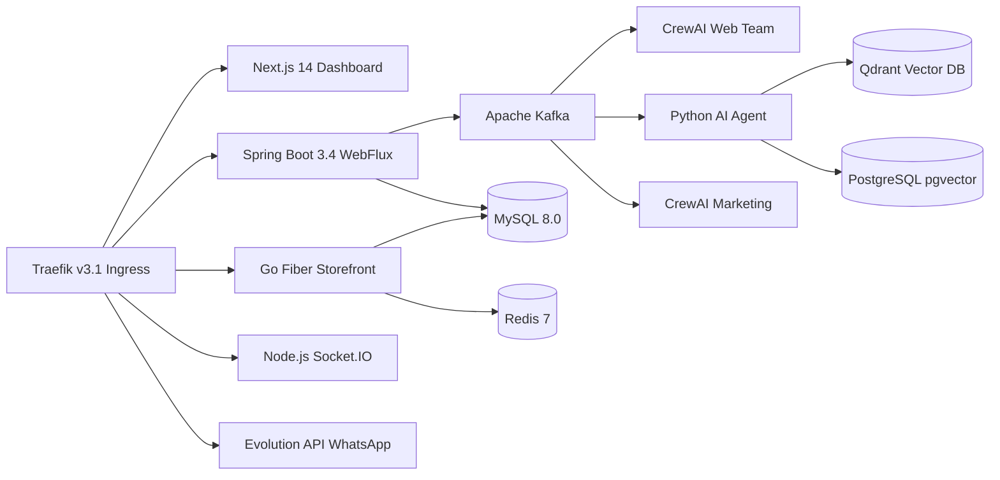

# Resumen Ejecutivo de la Auditoría Tecnológica — CloudFly Business OS

**Fecha:** Noviembre 2026  
**Equipo Auditor:** Antigravity Senior Engineering Team  
**Propósito:** Evaluación exhaustiva del proyecto para arquitectos de software, CTO y agentes de IA evaluadores.

---

## 1. Estado General del Proyecto

CloudFly es un Business OS SaaS multi-tenant con un nivel de avance significativo. Lejos de ser un prototipo en papel, cuenta con una infraestructura real de microservicios en producción (desplegada en VPS mediante Docker Compose y Traefik), con flujos reactivos basados en Kafka y componentes frontend modernos en Next.js 14.

Sin embargo, el sistema presenta una **dualidad técnica**:
- Por un lado, tiene componentes centrales altamente maduros y de alto rendimiento (Backend WebFlux, Storefront público en Go Fiber con caché Redis, y un equipo de agentes de CrewAI construyendo tiendas virtuales).
- Por otro lado, arrastra **deuda técnica y brechas de seguridad críticas** derivadas de iteraciones rápidas, incluyendo bypasses de autenticación con cadenas hardcodeadas, herramientas con permisos SQL peligrosos entregadas a LLMs, y módulos comerciales (como el POS local o la facturación DIAN) que aún no están 100% cohesionados en el flujo web principal.

---

## 2. Arquitectura Tecnológica Real

- **Frontend:** `frontend_new/` (Next.js 14 App Router, TypeScript, MUI, Tailwind, Redux).
- **Core API:** `backend_new/` (Java 17, Spring Boot 3.4 WebFlux, Spring Data R2DBC, JWT).
- **Tienda Pública:** `cloudfly-storefront/` (Go 1.21, GoFiber, HTML templates, Redis caching).
- **Constructor de Tiendas:** `web-team/` (Python 3.11, CrewAI, Kafka consumer, Redis invalidation).
- **Mensajería y Chat:** `chat-socket-service/` (Node.js/Socket.IO) y `evolution-api/` (WhatsApp).
- **Pagos:** `billing-service/` (Go, Pasarela Wompi Colombia).
- **IA Conversacional:** `ai-agent/` (Python, LangChain, Qdrant, PostgreSQL pgvector).

---

## 3. Módulos Terminados y Comprobados vs. Funcionalidades Parciales

### 3.1. Terminados y Verificados (Ready)
- **Autenticación y Sesiones:** Flujo de registro, login, verificación de correo y emisión de JWT multi-tenant.
- **Catálogo y Productos:** CRUD de productos, categorías, imágenes y precios con aislamiento por tenant.
- **Pipeline de Generación de Tiendas Virtuales:** Proceso asíncrono con Kafka que genera temas y layouts a partir del perfil de la empresa y los publica en base de datos e invalida caché.
- **Storefront Público:** Renderizado de alta velocidad en Go Fiber con soporte de dominios personalizados por tenant.
- **Integración de WhatsApp:** Envío y recepción de mensajes vía webhooks de Evolution API.
- **Pasarela de Pagos (Wompi):** Cliente Wompi implementado en Go para transacciones en Colombia.

### 3.2. Funcionalidades Parciales o No Cohesionadas
- **Checkout en Storefront:** Las plantillas de la tienda muestran productos y botón de compra, pero el carrito y la redirección a Wompi requieren integración fluida con la creación de la orden en el backend.
- **Punto de Venta (POS):** Existe una app funcional en Python (`pos-python`) con base SQLite local, pero opera desconectada del dashboard web de ventas.
- **Facturación Electrónica DIAN:** Microservicio existente en Java (`cloudfly-dian-service`), pero no verificado contra el entorno de habilitación de la DIAN en vivo.
- **Analítica de Negocio:** La UI muestra métricas, pero se apoyan en datos simulados (`demoMetrics.ts`).

---

## 4. Estado de los Agentes de IA

- **Web Team (Crews de Tiendas):** Funciona de forma autónoma con 5 crews. Sin embargo, la herramienta `logo_analyzer` está **mockeada** (deduce colores por el nombre del archivo en lugar de analizar la imagen real).
- **AI Scrum Team:** Altamente funcional para desarrollo interno, con agentes coordinados que resuelven requerimientos sobre Jira.
- **Marketing Team AI:** Capaz de generar copys persuasivos y analizar nichos B2B, pero requiere completar la integración con la interfaz de usuario para que el cliente final dispare campañas con un clic.
- **Gobernanza:** Falta un control de presupuesto y límite de tokens estricto por cada empresa suscriptora.

---

## 5. Riesgos Críticos y Bloqueos de Lanzamiento

1. **Bypass de Seguridad en Controladores (P0):** Presencia de la cadena fija `"cloudfly_ai_secret_2026"` en `OrderController.java` y `QuoteController.java` que permite saltarse la autenticación como `ROLE_ADMIN`.
2. **Herramienta SQL Arbitraria en Agente (P0):** `mysql_tool` en `web-team/src/tools.py` permite que el LLM ejecute sentencias SQL directas contra la base de datos de producción sin filtro forzoso de tenant.
3. **Mapeo de Puerto MySQL al Exterior (P0):** En `docker-compose-full-vps.yml`, MySQL expone el puerto `3306` al host.
4. **Manipulación de Tenant vía Header (P1):** Posibilidad de sobreescribir el inquilino en `QuoteController.java` enviando la cabecera `x-tenant-id`.

---

## 6. Las 10 Acciones Prioritarias Inmediatas

1. **Eliminar el bypass `"cloudfly_ai_secret_2026"`** en `OrderController` y `QuoteController`.
2. **Eliminar la herramienta `mysql_tool`** en `web-team/src/tools.py` y usar exclusivamente el repositorio tipado.
3. **Cerrar el puerto `3306`** de MySQL en `docker-compose-full-vps.yml` eliminando la directiva `ports:`.
4. **Eliminar la sobreescritura de `tenant_id` por header** en `QuoteController.java`.
5. **Reemplazar el mock de `logo_analyzer`** con extracción real de paleta cromática usando `Pillow` o `color-thief-py`.
6. **Conectar el checkout de Wompi** en las plantillas de `cloudfly-storefront` para cerrar el ciclo de compra de la tienda online.
7. **Sincronizar la rama principal** con `origin/main` (`git pull`) y validar compilación limpia.
8. **Implementar límites de consumo de tokens (cuotas)** por tenant en `ai-agent` y `web-team`.
9. **Generar rutas `/sitemap.xml` y `/robots.txt`** dinámicas en el servidor Go de storefront.
10. **Alinear el módulo POS:** Definir si la estrategia comercial priorizará el POS web en `frontend_new` o la distribución empaquetada de `pos-python`.

---

## 7. Recomendación para el Próximo Sprint

**Sprint de Blindaje y Activación Comercial (Sprint P0/P1):**
- **Días 1 a 3:** Resolver los 4 hallazgos de seguridad (remover bypasses, eliminar `mysql_tool`, cerrar puerto 3306 y asegurar inmutabilidad de tenant desde el JWT).
- **Días 4 a 6:** Implementar la extracción real de colores de logo en `web-team` y asegurar el flujo de carrito y pago Wompi en `cloudfly-storefront`.
- **Días 7 a 10:** Pruebas E2E completas del flujo de registro, generación automática de tienda y compra simulada en pasarela. Con esto, CloudFly estará **100% listo para salir a comercializar su MVP con clientes reales de forma segura.**

